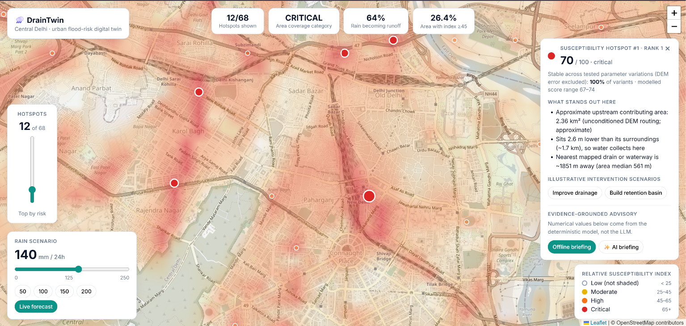
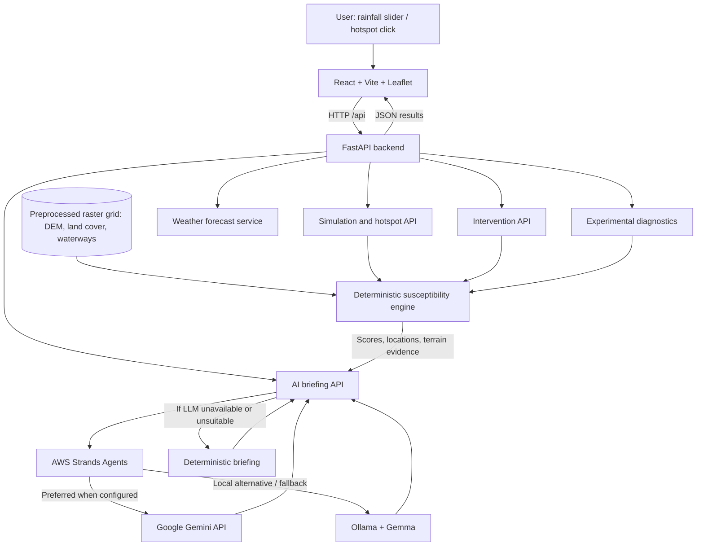
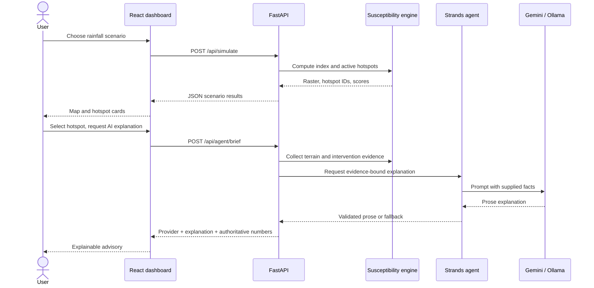
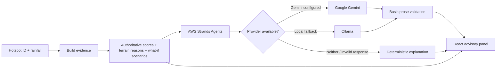

<div align="center">

# 🌧️ DrainTwin

### A geospatial digital twin for exploring urban flood susceptibility in Delhi

**From rainfall scenarios to explainable hotspots and AI-assisted planning — on one interactive map.**

[](frontend/)
[](backend/)
[](https://strandsagents.com/)
[](https://ai.google.dev/)
[](https://ollama.com/)

**Built for [Environmental Hacks — Bharat Builds Tour]**

[Features](#-what-you-can-do) · [Architecture](#-system-architecture) · [Quick start](#-quick-start) · [Model](#-how-the-susceptibility-model-works) · [AI](#-ai-advisory-architecture) · [Limitations](#-limitations-and-responsible-use)

</div>

> [!IMPORTANT]
> **DrainTwin is a research and hackathon prototype, not an operational flood warning system.** Its scores are **relative susceptibility indices**, not flood probabilities, measured inundation depths, or validated predictions. Intervention effects are illustrative what-if scenarios, not engineering recommendations.

---

## 🌍 The problem

Intense rainfall can turn ordinary city streets into waterlogging hotspots. In dense urban environments, runoff is influenced by terrain depressions, upstream contributing area, paved surfaces, and the location of mapped drainage channels. Understanding these interacting factors is difficult when the information lives in separate maps and datasets.

**The question DrainTwin explores:** *Under a chosen rainfall scenario, which locations in a defined urban study area appear relatively more susceptible to surface-water accumulation, why, and how might hypothetical changes to local conditions affect their modelled scores?*

DrainTwin turns that question into an interactive, explainable workflow. Instead of displaying an unexplained red dot, it connects each hotspot to terrain evidence, numerical scenario comparisons, and an optional AI-generated plain-language briefing.

## ✨ What you can do

| Capability | What it does |
|---|---|
| 🗺️ **Interactive susceptibility map** | Explore a rainfall-driven susceptibility layer over a zoomable Central Delhi map. |
| 🌧️ **Rainfall scenarios** | Change the assumed rainfall total (0–250 mm) and observe how the index and active hotspots respond. |
| 📍 **Stable hotspot locations** | Inspect candidate hotspot sites whose IDs remain stable between rainfall scenarios; sites become active when they pass the configured threshold. |
| 🔎 **Explainable terrain factors** | Read location-specific model explanations based on convergence, relative elevation, flatness and distance to mapped waterways/drains. |
| 🏗️ **What-if interventions** | Compare illustrative retention-basin, drainage-improvement and permeable-surface scenarios with the unmodified model. |
| 🤖 **AI planning briefings** | Generate a plain-language explanation using **AWS Strands Agents + Gemini**, with **Ollama** and deterministic fallback. |
| ☁️ **Forecast-assisted scenario** | Optionally load a next-24-hour rainfall forecast, or keep full manual control of the scenario. |
| 🧪 **Experimental diagnostics** | Inspect rainfall sensitivity, DEM pit diagnostics and experimental spatial comparisons through API endpoints. |

### 📸 Screenshots

> **Add your screenshots** to `docs/screenshots/` using the filenames below. The images will display automatically once committed. Replace filenames in this README if yours differ.

#### 1. Main dashboard — rainfall scenario and susceptibility map



#### 2. Hotspot inspection and intervention scenarios


#### 3. Gemini explanation powered by AWS Strands Agents


<!-- Optional: replace this placeholder with a YouTube, Drive or hosted video link after recording. -->
**Demo video:** _Coming soon — add a link here after recording the walkthrough._

---

## 🧭 Study area and scope

| Property | Current prototype |
|---|---|
| Geographic focus | **Central Delhi, India** — not the whole city |
| Study bounds | South **28.56°**, West **77.15°**, North **28.70°**, East **77.30°** |
| Analysis grid | **64 × 64 cells** |
| Main scenario input | Rainfall total in **mm**, from **0 to 250** |
| Primary output | Relative susceptibility index on a **0–100** scale |
| Main approach | Transparent, deterministic geospatial scoring with heuristic parameters |
| Data mode | Real preprocessed grid when available; explicitly labelled synthetic demo grid otherwise |

A grid cell represents a relatively large area. The prototype does **not** resolve individual underpasses, inlet capacity, curb geometry, or street-level flood depths.

## 🏗️ System architecture



**Design principle:** The deterministic geospatial engine is the source of numerical scores. The LLM **explains** the supplied evidence; it does not compute authoritative risk scores or engineering outcomes.

### Request lifecycle



### Technology stack

| Layer | Technology | Role |
|---|---|---|
| UI | React 18, Vite | Interactive controls and state management |
| Map | Leaflet | Geospatial visualization and hotspot selection |
| API | FastAPI, Pydantic | Typed requests, responses and API documentation |
| Computation | Python, NumPy, SciPy | Raster-based susceptibility, hotspot extraction and perturbation experiments |
| Geospatial inputs | Elevation/DEM, land cover, OpenStreetMap waterways | Terrain, surface cover and drainage-proximity proxies |
| Agent orchestration | AWS Strands Agents | Model-backed explanation workflow and provider switching |
| Cloud model | Google Gemini API | Preferred explanation model when configured |
| Local model | Ollama (e.g. `gemma3:4b`) | Local model and cloud fallback |
| Forecast | Open-Meteo | Optional rainfall scenario input |
| Testing | pytest | Backend regression checks |

> AWS Strands Agents is an SDK used locally in this project. **Using Strands does not mean the app is deployed to AWS.** AWS hosting is a possible future extension.

---

## ⚡ Quick start

### Prerequisites

- **Python 3.10+** and `pip`
- **Node.js 18+** and `npm`
- **Git**
- Optional: **Gemini API key** from [Google AI Studio](https://aistudio.google.com/apikey)
- Optional: [Ollama](https://ollama.com/) for local model inference

### 1. Clone the repository

```powershell
git clone https://github.com/SarveshDujari/DrainTwin.git
cd DrainTwin
```

### 2. Install and start the backend (PowerShell)

```powershell
cd backend
python -m venv .venv
.\.venv\Scripts\Activate.ps1
python -m pip install -r requirements.txt
python -m pip install -r requirements-agents.txt
Copy-Item .env.example .env
notepad .env
```

> If PowerShell blocks activation, you can run `.\.venv\Scripts\python.exe` instead of `python`, or use a terminal where virtual-environment activation is enabled.

For Gemini-first mode, set these values in `backend/.env`:

```dotenv
STRANDS_ENABLED=1
AI_PROVIDER=auto
GEMINI_API_KEY=your_key_here
GEMINI_MODEL=gemini-2.5-flash
OLLAMA_HOST=http://localhost:11434
OLLAMA_MODEL=gemma3:4b
AI_TIMEOUT_SECONDS=35
CORS_ORIGINS=http://localhost:5173,http://127.0.0.1:5173
```

**Never commit a real API key.** `backend/.env` must remain excluded from Git. The Gemini key belongs in the backend, not in frontend `VITE_` variables.

Start FastAPI:

```powershell
python -m uvicorn app.main:app --reload
```

Backend: **http://127.0.0.1:8000**  
Interactive API docs: **http://127.0.0.1:8000/docs**

### 3. Start the frontend (second terminal)

From the repository root:

```powershell
cd frontend
npm install
npm run dev
```

Open **http://localhost:5173**.

Vite proxies `/api` requests to the local FastAPI server. For a separately hosted frontend, you can configure `VITE_API_URL` in `frontend/.env` as described in `frontend/.env.example`.

### 4. Optional: run Ollama locally

```powershell
ollama pull gemma3:4b
```

Ensure Ollama is running. The configured default endpoint is `http://localhost:11434`. If Gemini is not configured or a provider fails, the backend can try Ollama and ultimately return a deterministic explanation.

### 5. Confirm everything works

1. Open the dashboard and change the rainfall slider.
2. Click an active hotspot and inspect the terrain evidence.
3. Compare one illustrative intervention scenario.
4. Click **Offline briefing** to verify the no-LLM path.
5. Click **AI briefing** and confirm whether the UI labels the provider **Strands + Gemini** or **Strands + Ollama**.
6. Open `http://127.0.0.1:8000/api/agent/status` to inspect provider configuration. **Configuration status is not a live connectivity guarantee.**

### Data preparation: real versus demo

The engine loads `backend/data/delhi_grid.npz` when present. If absent, it uses `backend/data/delhi_grid_demo.npz` if available; the frontend identifies synthetic demo mode. **Do not describe demo-mode results as real Delhi terrain analysis.**

To generate the synthetic example grid if needed:

```powershell
cd backend
python preprocessing/make_demo_data.py
```

To regenerate the real-data grid using the preprocessing pipeline and its external inputs:

```powershell
cd backend
python -m pip install -r requirements-data.txt
python preprocessing/build_grid.py
```

Real-data preprocessing can require downloads and access to upstream datasets. See the scripts in `backend/preprocessing/` for their exact source requirements. Confirm the real grid was generated before recording a real-data demo.

---

## 🧠 How the susceptibility model works

DrainTwin is deliberately **not a black-box flood classifier**. It combines an assumed runoff response with static spatial susceptibility factors.

### Step 1 — Prepare the spatial layers

The preprocessing workflow assembles raster-aligned representations of:

1. **Elevation:** local topography derived from a digital elevation model (DEM).
2. **Slope:** local terrain steepness derived from elevation.
3. **Flow accumulation:** an estimate of upstream contributing cells under the routing assumptions.
4. **Imperviousness:** a land-cover-based proxy for surfaces where rainfall infiltrates less readily.
5. **Distance to mapped waterways/drains:** a spatial proxy derived from available mapped features.
6. **Water mask:** prevents open-water cells from being reported as terrestrial hotspots.

These layers are resampled/aligned to the study grid and stored in a NumPy `.npz` file for fast scenario evaluation.

### Step 2 — Convert rainfall into a runoff proxy

The engine uses an **SCS Curve Number (CN)**-style runoff equation:

```text
S  = 25400 / CN - 254
Ia = 0.2 × S

Q = 0                                  if P <= Ia
Q = (P - Ia)² / (P + 0.8 × S)          if P > Ia
```

Where `P` is rainfall (mm), `Q` is estimated runoff depth (mm), `S` is potential retention, and `Ia` is initial abstraction. The prototype varies the assumed curve number with imperviousness, using approximate values from **61** (open ground) to **98** (highly paved). These are modelling assumptions, **not locally calibrated soil measurements**.

### Step 3 — Estimate static spatial susceptibility

The model normalizes four terrain-related indicators and combines them using explicit weights:

| Factor | Weight | Interpretation |
|---|---:|---|
| Flow convergence | 0.35 | Relative upstream contributing area |
| Local depression | 0.30 | Lower elevation relative to the surrounding neighbourhood |
| Flatness | 0.20 | Lower local slope under the model's assumptions |
| Distance to mapped drains | 0.15 | Drainage-proximity proxy, not actual drain capacity |

```text
susceptibility =
    0.35 × convergence
  + 0.30 × local_depression
  + 0.20 × flatness
  + 0.15 × drainage_distance
```

**Important:** These weights are heuristic. The drainage-distance assumption can conflict with other interpretations of waterway proximity and should not be treated as independently validated.

### Step 4 — Combine runoff and susceptibility

The relative index is computed as:

```text
index = clip(
    100 × hazard^0.6 × (0.25 + 0.75 × susceptibility),
    0, 100
)
```

`hazard` is a normalized function of estimated runoff depth. Water cells are masked. The output is a **relative index**; a value of 70 does **not** mean a 70% chance of flooding.

### Step 5 — Identify stable hotspot sites

Candidate sites are selected from local maxima under a high-rainfall reference scenario. Their locations and IDs stay stable as rainfall changes. A site is shown as an active hotspot when its current score crosses the configured threshold (**45** in the current engine). The spacing/local-maximum window affects how many sites exist.

This improves scenario-to-scenario comparison, but it also creates threshold effects: hotspot counts can change sharply between rainfall totals. The number of hotspots is therefore **not a count of observed flooded streets**.

### Step 6 — Explore model stability

The backend can rerun scenarios with perturbed parameters to report how consistently a hotspot remains flagged under **those assumed parameter ranges**. This is a sensitivity/stability diagnostic, **not statistical confidence or calibrated predictive uncertainty**. It does not comprehensively capture DEM error, drainage capacity, or model-structure uncertainty.

### Step 7 — Compare illustrative interventions

DrainTwin locally modifies model inputs within a neighbourhood around the selected site and recomputes the index. Available scenario types include:

| Scenario | Conceptual change | What the result means |
|---|---|---|
| Retention basin | Reduce local effective runoff/retention-related parameters | Illustrative change in the modelled index |
| Drainage improvement | Adjust drainage-related susceptibility assumptions | Illustrative change in the modelled index |
| Permeable surfaces | Reduce effective imperviousness/runoff response | Illustrative change in the modelled index |

The scenarios are **parameter perturbations**, not hydraulic simulations or costed engineering designs. The apparent highest reduction does not establish the best real-world intervention.

---

## 🤖 AI advisory architecture

The AI component is intentionally downstream of the deterministic risk engine.



### Provider selection

| Backend configuration | Behaviour |
|---|---|
| `AI_PROVIDER=auto` | Prefer Gemini if a key is configured; otherwise use Ollama; finally use deterministic fallback. |
| `AI_PROVIDER=gemini` | Prefer Gemini, with other configured fallbacks available. |
| `AI_PROVIDER=ollama` | Prefer local Ollama, with other configured fallbacks available. |
| `STRANDS_ENABLED=0` | Deterministic briefing only. |

**Why use an agent at all?** Strands provides a consistent interface for model-backed, evidence-grounded explanations across cloud and local inference. In the current prototype, the agent primarily performs **constrained explanation generation**; it is not an autonomous city-planning system or a substitute for hydrological modelling.

### Guardrails and provenance

- The engine supplies authoritative numerical values and intervention comparisons.
- The model is instructed to explain the supplied evidence rather than invent new scores.
- Basic output checks can reject unsuitable model text and trigger a fallback.
- The UI identifies the provider that actually generated the explanation.
- A deterministic offline path keeps the demo usable without a cloud key or local LLM.
- **These checks are not comprehensive factual verification.** Generated prose should still be reviewed critically.

**Privacy:** Gemini mode sends selected hotspot evidence to a cloud API. Ollama can process explanations locally. No Gemini API key is sent to the frontend.

---

## 🔌 API reference

FastAPI provides interactive documentation at [`/docs`](http://127.0.0.1:8000/docs) when the backend is running.

| Method | Endpoint | Purpose |
|---|---|---|
| `GET` | `/api/area` | Study bounds, configuration and current data source |
| `POST` | `/api/simulate` | Generate a rainfall-driven susceptibility scenario |
| `POST` | `/api/intervention` | Re-score a selected hotspot under a hypothetical intervention |
| `GET` | `/api/weather` | Retrieve forecast-assisted rainfall input |
| `GET` | `/api/agent/status` | Report configured AI provider availability flags |
| `POST` | `/api/agent/brief` | Request offline or Strands-backed hotspot explanation |
| `GET` | `/api/validation` | Access research-stage validation information |
| `GET` | `/api/experimental/rainfall-sensitivity` | Explore score and hotspot changes across rainfall scenarios |
| `GET` | `/api/experimental/dem-routing-diagnostics` | Inspect terrain-routing pit diagnostics |
| `GET` | `/api/phase3/diagnostics` | Experimental spatial diagnostics (legacy route name) |
| `GET` | `/api/phase3/scenarios` | Rainfall scenario sweep (not historical storm replay) |
| `GET` | `/api/phase3/compare` | Experimental baseline/proxy comparison |
| `GET` | `/api/phase3/layers` | Experimental raster layers |

### Example: generate a scenario

```powershell
Invoke-RestMethod `
  -Uri "http://127.0.0.1:8000/api/simulate" `
  -Method POST `
  -ContentType "application/json" `
  -Body '{"rainfall_mm":100}'
```

### Example: request an AI explanation

```powershell
$body = @{
  hotspot_id = 1
  rainfall_mm = 150
  use_agent = $true
} | ConvertTo-Json

Invoke-RestMethod `
  -Uri "http://127.0.0.1:8000/api/agent/brief" `
  -Method POST `
  -ContentType "application/json" `
  -Body $body
```

A response includes the generation mode, a summary, the evidence used, and a disclaimer. The actual provider can differ from the preferred provider when fallback is triggered.

---

## 📁 Project structure

```text
DrainTwin/
├── backend/
│   ├── app/
│   │   ├── main.py                 # FastAPI application and routes
│   │   ├── api/                    # Simulation, intervention, AI, validation, diagnostics
│   │   ├── agents/planner.py       # Evidence building, Strands providers, fallback
│   │   ├── engine/
│   │   │   ├── risk.py             # Runoff, susceptibility and hotspot logic
│   │   │   ├── interventions.py    # Illustrative intervention definitions
│   │   │   └── phase3.py           # Experimental spatial diagnostics
│   │   ├── models/                 # API request/response schemas
│   │   └── services/               # Forecast and validation services
│   ├── data/                       # Grid artifacts and validation candidates
│   ├── preprocessing/              # DEM, land cover, OSM, validation helpers
│   ├── tests/                      # Backend regression tests
│   ├── requirements.txt
│   ├── requirements-agents.txt
│   ├── requirements-data.txt
│   ├── requirements-dev.txt
│   └── .env.example
├── frontend/
│   ├── src/
│   │   ├── App.jsx                # Dashboard and scenario state
│   │   ├── components/            # Map, controls, hotspot and AI panels
│   │   └── services/api.js        # API client
│   ├── package.json
│   └── vite.config.js
├── docs/
│   └── screenshots/               # Add your images here
├── .gitignore
└── README.md
```

The `docs/screenshots/` folder is a **suggested addition**, not required by the application. Some experimental modules retain development-era filenames for backward compatibility.

---

## 🧪 Testing and reproducibility

Run backend tests:

```powershell
cd backend
python -m pip install -r requirements-dev.txt
python -m pytest -q
```

Check the frontend production build:

```powershell
cd frontend
npm install
npm run build
```

Useful reproducibility checks:

- Confirm `GET /api/area` reports the intended **real** or **demo** data source.
- Check scenarios at multiple rainfall totals rather than relying on one screenshot.
- Confirm a hotspot ID remains associated with the same location as rainfall changes.
- Compare intervention values to the deterministic API output.
- Test Gemini, Ollama, and offline briefing modes separately.
- Test the UI at desktop and mobile widths.

### Historical validation status

The repository contains a research-stage CSV of **42 candidate** waterlogging locations gathered for review. Candidate entries are **not equivalent to independently verified ground truth**. Coordinate verification and dated-event matching remain incomplete; consequently **no predictive accuracy, precision, recall or validated lift is claimed**.

Validation scripts are retained in `backend/preprocessing/`, even if the experimental historical-validation panel is hidden from the main UI.

---

## ⚠️ Limitations and responsible use

| Limitation | Implication |
|---|---|
| Coarse 64×64 study grid | Cannot resolve individual street drains, underpasses or micro-topography. |
| DEM and flow-routing assumptions | Local depressions and upstream area estimates may be distorted by data errors or unconditioned sinks. |
| Heuristic weights and thresholds | Index values are not calibrated probabilities or observed flood levels. |
| Rainfall total rather than storm intensity | The engine does not fully represent peak-hour intensity versus actual drainage capacity. |
| Mapped drainage proximity | Map completeness and real drain performance are unknown. |
| Modelled interventions | Score changes are not guarantees of flood reduction, feasibility or cost-effectiveness. |
| Limited verified historical observations | Predictive skill has not been established. |
| AI-generated narrative | Helpful for interpreting model evidence, but not independently verified expert advice. |
| Experimental diagnostics | Alternative spatial proxies and sensitivity checks are not proven improvements to predictive skill. |

**Do not use DrainTwin for emergency alerts, evacuation decisions, infrastructure design approval, or public-safety forecasts.** It is a decision-support *exploration prototype* intended for demonstration and further research.

## 🚀 Future directions

1. **Ground-truth verification:** confirm historical locations, event dates and associated rainfall.
2. **Higher-resolution terrain:** evaluate improved DEM sources, drainage connectivity and underpass geometry.
3. **Hydrology improvements:** test depression conditioning, storm intensity and drainage-capacity assumptions.
4. **Uncertainty analysis:** include spatially correlated elevation uncertainty and independent sensitivity tests.
5. **Model evaluation:** compare candidate methods against a sufficiently large, verified event dataset.
6. **Operational hardening:** add authentication, rate limits, observability and deployment checks before public hosting.
7. **Cloud deployment:** optionally host the frontend/API and selected inference services on AWS.

---

## 🙌 Data sources and acknowledgments

- **OpenStreetMap contributors** — mapped waterways and related geographic features; see [OpenStreetMap copyright](https://www.openstreetmap.org/copyright).
- **Open-Meteo** — forecast data and optional weather inputs; see [Open-Meteo](https://open-meteo.com/).
- **Elevation and land-cover datasets** — see the preprocessing scripts for the specific DEM and land-cover sources used to build the grid; retain their original attribution and usage requirements.
- **AWS Strands Agents**, **Google Gemini**, **Ollama**, **React**, **Leaflet**, **FastAPI**, **NumPy** and **SciPy** — software ecosystem used by the prototype.


