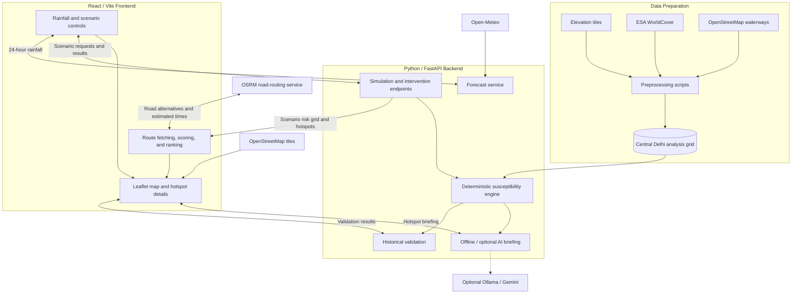

# DrainTwin 🌧️

### Exploring urban waterlogging susceptibility and rainfall-aware route planning in Central Delhi.

DrainTwin is an interactive, map-based **study prototype for the Central Delhi region**. It combines terrain analysis, land-cover information, rainfall scenarios, hotspot identification, and road-route comparison to explore how urban waterlogging susceptibility can inform local planning.

The project connects two practical questions: **where might water accumulate under a chosen rainfall scenario, and how might that change the routes or interventions worth considering?** Users can adjust rainfall, inspect the reasons behind modelled hotspots, compare driving routes, and explore illustrative improvements to drainage or surface permeability.

DrainTwin uses a transparent numerical model rather than a trained flood-prediction model. Its outputs are **relative susceptibility indicators**, intended for research, demonstration, and scenario comparison. They do not establish current flooding, road closures, or safe travel conditions.

**Built for the [Environmental Hacks event in the Bharat Builds Tour](https://www.wemakedevs.org/aws/env).**

## Project Preview

### Rainfall-Aware Route Planning

Choose a start and destination, compare available road routes, and explore the trade-off between estimated driving time and exposure to modelled waterlogging susceptibility.


### Hotspot Exploration

Explore the susceptibility surface, inspect individual hotspots, and understand the local factors contributing to their scores.


## Why DrainTwin?

Urban waterlogging depends on more than rainfall alone. Built-up surfaces affect how much water runs off, surrounding terrain influences where it converges, and local depressions or drainage conditions can affect where it accumulates.

A rainfall forecast provides useful context, but it does not directly explain these spatial differences. Similarly, a conventional route planner compares road travel without incorporating the susceptibility surface explored in this project.

DrainTwin brings these elements into one interface:

- **Spatial context:** identify places with relatively higher modelled susceptibility.
- **Scenario comparison:** examine how the same area responds to different rainfall amounts.
- **Travel trade-offs:** compare available routes using time and modelled exposure.
- **Planning exploration:** investigate how assumed local interventions change the model.

The emphasis is on making the reasoning visible. Users can inspect the inputs, assumptions, and local explanations behind a result instead of receiving an unexplained risk label.

## Study Area and Scope

The current implementation covers a rectangular Central Delhi study area:

| Property | Current scope |
| --- | --- |
| Geographic bounds | 28.56–28.70° N, 77.15–77.30° E |
| Analysis grid | 64 × 64 cells |
| Approximate cell dimensions | About 243 m north–south, with east–west dimensions varying by latitude |
| Rainfall input | A 24-hour rainfall scenario, up to 250 mm |
| Intended use | Study, demonstration, and comparative planning |

The study boundary does not represent all of Delhi or an exact administrative district boundary. Street-map detail provides geographic context; the underlying analysis remains at grid-cell resolution.

## Main Features

- **Interactive rainfall scenarios:** adjust the 24-hour rainfall amount and update the susceptibility map.
- **Forecast-assisted exploration:** load an Open-Meteo forecast to supply the rainfall scenario.
- **Stable hotspot locations:** follow the same candidate sites as rainfall changes.
- **Location-specific explanations:** inspect terrain, built-up surface, and drainage-related evidence.
- **Parameter stability estimates:** see how hotspot scores respond to tested modelling assumptions.
- **Route comparison:** choose Fastest, Balance time & risk, or Lower risk within an extra-time budget.
- **Intervention simulation:** compare illustrative drainage, permeable-surface, and retention scenarios.
- **Offline and optional AI briefings:** read an evidence-based summary of a selected hotspot.
- **Historical validation workflow:** review source-linked candidate locations before using them for evaluation.

## System Architecture

DrainTwin separates data preparation, numerical analysis, and interactive exploration.



### Data Preparation

Preprocessing converts elevation, land cover, and mapped waterways into a common grid stored in `backend/data/delhi_grid.npz`.

Preparing these layers in advance keeps interactive simulation lightweight: changing rainfall recalculates scores without downloading and processing the original datasets again.

### Numerical Backend

The FastAPI backend loads the prepared grid and calculates susceptibility scores, hotspots, local explanations, and intervention comparisons. It also provides forecast, validation, and advisory endpoints.

The deterministic engine supplies the numerical results. Optional AI integration adds explanatory prose.

### Interactive Frontend

The React application displays the analysis using Leaflet, manages scenario controls, and presents hotspot details.

**Route fetching and scoring run in the frontend.** The browser requests road geometries and estimated travel times from OSRM, then evaluates those routes against the scenario grid returned by the backend.

## Modelling Workflow and Design Choices

### 1. Prepare Terrain and Surface Information

The preprocessing pipeline combines three main sources:

| Input | Derived information | Why it is included |
| --- | --- | --- |
| SRTM-derived Terrarium elevation tiles | Elevation, slope, and approximate flow accumulation | Represents terrain conditions that influence water movement and collection |
| ESA WorldCover 2021 | Estimated imperviousness and a permanent-water mask | Distinguishes surfaces with different runoff behaviour and excludes existing water bodies |
| OpenStreetMap waterways | Distance to mapped drains or waterways | Provides an accessible drainage-related geographic proxy |

Terrain processing includes a surrounding buffer before cropping to the study area. This reduces the loss of upstream terrain context near the boundary. Intermediate outputs are cached so interrupted preprocessing can resume without repeating completed work.

Mapped waterways are a proxy, rather than a verified inventory of storm-drain capacity or condition.

### 2. Convert Rainfall into Estimated Runoff

The model uses the **SCS Curve Number method** to estimate local runoff from rainfall and surface imperviousness.

This introduces a rainfall response that differs between permeable and built-up surfaces. Light rainfall can produce zero estimated runoff on more permeable cells, while paved cells respond more strongly.

Curve numbers vary between assumed values of 61 for open ground and 98 for fully paved ground. These values are modelling assumptions rather than locally calibrated measurements.

The forecast option supplies the sum of 24 hourly precipitation intervals for a representative Delhi location. It provides a convenient scenario input; it does not supply observed flooding or spatially varying rainfall across the grid.

### 3. Calculate Relative Susceptibility

The engine combines estimated runoff with four spatial signals:

| Signal | Weight | Interpretation |
| --- | ---: | --- |
| Runoff convergence | 35% | Terrain-derived tendency for upstream contributions to concentrate |
| Local depression | 30% | Elevation below the surrounding neighbourhood |
| Flatness | 20% | Low slopes that may favour slower drainage |
| Distance to mapped drains or waterways | 15% | Relative separation from mapped drainage features |

The resulting index follows:

```text
index = clip(
    100 × hazard^0.6 × (0.25 + 0.75 × susceptibility),
    0,
    100
)

hazard = estimated local runoff / reference runoff
```

Reference runoff is calculated for a fully paved cell under a 175 mm rainfall scenario. Permanent-water cells are masked from the susceptibility output.

This structure combines rainfall response with location-specific conditions while keeping each component inspectable. Weights and display thresholds are hand-set and remain open to future calibration.

### 4. Identify Stable Hotspot Sites

Candidate hotspot sites are selected from local maxima in a fixed reference scenario. Their identifiers and positions remain stable when the rainfall slider changes.

A site becomes active when its current index reaches **45**. Display categories use thresholds of **25, 45, and 65**.

Stable sites make comparisons easier: users can follow how the same location responds to rainfall instead of seeing unrelated markers move between scenarios. These candidates are model-derived locations, rather than confirmed waterlogging sites.

The dashboard also reports the share of non-water cells above the hotspot threshold, providing broader context than the highest-scoring cell alone.

### 5. Explain Hotspots and Test Parameter Stability

Hotspot explanations highlight local signals that stand out relative to the study-area median, such as greater built-up cover, a local depression, or distance from mapped waterways.

The engine also repeats calculations across **100 parameter variations**, perturbing feature weights, curve numbers, and the rainfall-response exponent.

The displayed stability percentage describes how often a candidate remains above the hotspot threshold under those variations. Its score range summarises the resulting variation.

This helps expose sensitivity to assumptions. It is not a probability of flooding and does not capture every source of uncertainty, including DEM elevation error.

### 6. Compare Road Routes

The route planner requests driving alternatives from OSRM. It can also explore additional waypoint-based detours around selected hotspots encountered by the fastest route.

Each candidate route is sampled at approximately **40 m intervals** and evaluated using:

- Estimated driving time and route distance.
- Distance-weighted susceptibility exposure.
- Distance through cells with an index of 45 or higher.
- Distinct active hotspots within 300 m.
- Whether any part of the route leaves the assessed area.

The sampling interval helps evaluate route geometry consistently; it does not increase the resolution of the underlying analysis grid.

Duplicate routes and alternatives that are slower without improving either exposure measure are filtered out. Users can then select:

| Preference | Comparison approach |
| --- | --- |
| Fastest | Prioritises estimated driving time |
| Balance time & risk | Combines time with illustrative penalties for modelled exposure and nearby hotspots |
| Lower risk | Prioritises lower modelled exposure within the extra-time budget |

The balanced penalty represents a preference trade-off and is not added to the displayed driving ETA. Routes leaving the study area are flagged because their exposure is only partly assessed.

The planner compares the candidates it obtains; it does not perform a complete flood-aware search across the road network.

### 7. Explore Local Interventions

Users can test three illustrative intervention types:

- **Improve drainage:** reduce selected drainage, convergence, and runoff-related inputs.
- **Add permeable surface:** reduce estimated imperviousness.
- **Build retention basin:** reduce selected convergence and runoff-related inputs.

These changes are applied within a local footprint of approximately 500 m around the selected hotspot. The engine recalculates the index and reports a before-and-after comparison.

This creates a consistent way to explore different intervention mechanisms. The multipliers are assumed effects, so the results do not establish engineering performance, construction feasibility, or cost.

### 8. Generate a Hotspot Briefing

An offline briefing is available without an external language model. Optional AI briefings use the Strands Agents integration with Ollama or Gemini, depending on configuration.

The advisory layer receives existing hotspot evidence and helps explain it in prose. Numerical scores and intervention values remain grounded in the deterministic engine. Provider failures or rejected responses can fall back to an explicitly labelled offline briefing.

## Historical Validation

The repository includes source-linked candidate waterlogging locations and tools for reviewing their coordinates.

Candidate records require manual verification before they can contribute to evaluation. The interface withholds performance figures when fewer than ten verified, in-area points are available.

The reference comparison uses a **150 mm rainfall scenario, the top 12 hotspots, and a 300 m matching radius**. These defaults provide a reproducible starting point.

This remains an exploratory spatial comparison: historical reports are not matched to individual rainfall events, and the comparison that removes drainage weighting uses the same fixed candidate sites. It is an ablation study rather than an independent predictive baseline.

**DrainTwin does not currently claim validated flood-prediction accuracy.**

## Technology Stack

| Layer | Technologies |
| --- | --- |
| Web interface | React, Vite, Leaflet |
| API and numerical model | Python, FastAPI, NumPy, SciPy |
| Geospatial preparation | Rasterio, Pillow, elevation and land-cover processing |
| Road routing | OSRM |
| Rainfall forecast | Open-Meteo |
| Optional advisory | Strands Agents, Ollama, Gemini |
| Checks | Pytest, Node.js test runner, Vite build |

## Project Structure

```text
DrainTwin/
├── backend/
│   ├── app/
│   │   ├── api/              # Simulation, interventions, validation, advisory
│   │   ├── engine/           # Susceptibility and intervention calculations
│   │   ├── agents/           # Optional advisory integration
│   │   ├── models/           # Request and response schemas
│   │   └── services/         # Weather and validation services
│   ├── data/                 # Prepared grids and validation records
│   ├── preprocessing/        # Grid preparation and coordinate review
│   └── tests/                # Backend checks
├── frontend/
│   └── src/
│       ├── components/       # Map, controls, hotspots, and route planner
│       └── services/         # API calls, route scoring, and landmarks
└── docs/
    └── screenshots/          # Project screenshots
```

## Run Locally

You need **Python 3.10+** and **Node.js 18+**. Start the backend and frontend in separate terminals.

### 1. Start the Backend

From the repository root:

```bash
cd backend
python -m pip install -r requirements.txt
python -m uvicorn app.main:app --reload
```

API: `http://localhost:8000`  
Interactive API documentation: `http://localhost:8000/docs`

The backend loads `data/delhi_grid.npz` when available. Otherwise, it uses the bundled synthetic demo grid, which the interface labels accordingly.

### 2. Start the Frontend

```bash
cd frontend
npm install
npm run dev
```

Open `http://localhost:5173`.

Internet access is required for external map tiles, forecasts, and road-route requests. Route coordinates are sent to the configured OSRM service.

### 3. Rebuild the Analysis Grid — Optional

From `backend/`:

```bash
python -m pip install -r requirements-data.txt
python preprocessing/build_grid.py
python preprocessing/validate.py
```

Restart the backend after rebuilding the grid.

### 4. Enable AI Briefings — Optional

From `backend/`:

```bash
python -m pip install -r requirements-agents.txt
```

Copy `.env.example` to `.env`, then configure the provider and set `STRANDS_ENABLED=1`.

For local Ollama:

```bash
ollama pull gemma3:4b
```

Keep Ollama running and configure its host and model in `.env`. Gemini requires a backend API key and sends briefing evidence to the cloud provider. Keep keys out of frontend configuration and version control.

Offline briefings remain available without either provider.

## Suggested Demo Walkthrough

1. Start both services and confirm which grid is loaded.
2. Set a rainfall scenario, such as 150 mm, and inspect map shading and affected-area coverage.
3. Select a hotspot and review its contributing factors and parameter stability.
4. Apply an illustrative intervention and compare the resulting index.
5. Open **Plan a route** and choose endpoints using the map or landmark presets.
6. Compare the three route preferences and adjust the maximum extra travel time.
7. Change rainfall and observe how route exposure and recommendations respond.
8. Inspect the historical validation panel and its verification status.

## Limitations

- **Spatial detail:** the Central Delhi grid cannot resolve individual drains, road elevations, underpasses, or building-scale flow paths.
- **Model calibration:** weights, thresholds, runoff parameters, and intervention effects are assumed; verified, event-matched evidence remains insufficient for accuracy claims.
- **Hydrological coverage:** drainage capacity, blockages, storm timing, and dynamic flood propagation are not modelled.
- **Routing coverage:** recommendations compare available candidates using modelled exposure; they exclude live traffic, confirmed flooding, and road closures.
- **Advisory reliability:** AI prose requires review, and external services introduce availability and data-sharing dependencies.

## Future Improvements

1. **Strengthen validation and calibration.** Verify historical coordinates and event dates, pair observations with rainfall records, and evaluate on held-out events before tuning or publishing performance claims.

2. **Improve physical detail.** Introduce genuinely higher-resolution terrain and road-elevation data, a verified drainage network, and reliable underpass information. Reassess depression handling and flow routing before expanding the study area.

3. **Represent storm and drainage behaviour.** Add rainfall intensity over time, measured drainage capacity, blockage scenarios, and dynamic runoff routing to move beyond a uniform daily-rainfall comparison.

4. **Build more complete route assessment.** Explore road-network routing with exposure-aware costs, incorporate verified closures where available, and represent uncertainty across entire journeys.

5. **Make intervention estimates evidence-based.** Replace assumed multipliers with measured infiltration, storage, and capacity parameters, then include site feasibility and cost comparisons.

6. **Improve uncertainty, access, and deployment.** Include terrain and data-quality uncertainty, strengthen accessible map alternatives and mobile use, and add service monitoring, rate limits, and deployment safeguards.

## Checks

From `backend/`:

```bash
python -m pip install -r requirements-dev.txt
python -m pytest -q
```

From `frontend/`:

```bash
npm test
npm run build
```

These checks support software correctness and reproducibility. Scientific validation requires independent observations and a separate evaluation process.
