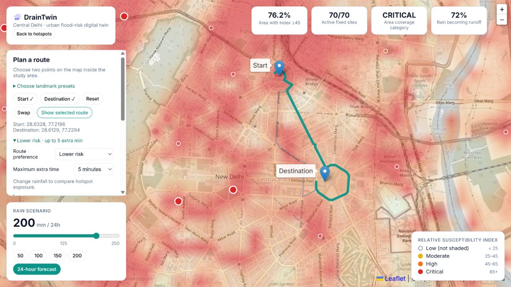
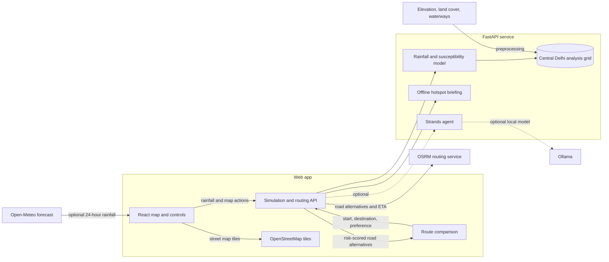

# DrainTwin 🌧️

### Explore urban waterlogging risk across Central Delhi—and compare routes before the rain gets worse.

DrainTwin is a map-based flood-susceptibility and route-planning demo. Choose a rainfall scenario, see where the model marks higher relative risk, and compare driving routes by estimated time and exposure to modelled hotspots.

**Built for the [Environmental Hacks event in the Bharat Builds Tour](https://www.wemakedevs.org/aws/env).**



## What you can do

- **Explore a rain scenario.** Set a 24-hour rainfall amount or load a live forecast, then see how the susceptibility map and hotspot indicators respond.
- **Compare routes.** Pick start and destination points on the map or use landmark presets. Compare the fastest option with a balanced or lower-risk route, with an adjustable time budget for detours.
- **See why a route ranks higher.** Route cards show estimated drive time, nearby modelled hotspots, and distance through higher-risk parts of the study area.
- **Inspect a hotspot.** View the model signals behind its score and confidence, try illustrative drainage or retention interventions, and read an always-available offline briefing.
- **Understand the scenario.** The dashboard reports affected-area coverage and other indicators so the map is more than a collection of red dots.

## How it works

The browser sends a rainfall scenario to a small API. The API scores a precomputed terrain and land-cover grid. The map overlays that score on street tiles, while the route planner requests road alternatives and scores them against the same risk surface. A forecast can supply the rainfall amount; it does not provide flood observations.



### The model, in plain language

The backend combines estimated rain runoff with terrain and drainage-related signals to produce a **relative susceptibility index** for each grid cell. It identifies a fixed set of candidate sites and shows which ones cross the display threshold for the selected scenario. These scores help compare places and scenarios; they are not probabilities, observed flood depths, or verified road conditions.

For routing, the app asks OSRM for road alternatives, samples each route against the risk grid, and compares estimated time and exposure to higher-risk cells and nearby hotspots. The selected preference controls how much extra travel time is acceptable. Rainfall changes update the route scores, though the same route can still rank best when alternatives are less favorable. Drive times are estimates and do not include live traffic.

## Project layout

| Path | Purpose |
| --- | --- |
| `frontend/` | React, Vite, Leaflet map, scenario controls, hotspot details, and route comparison UI |
| `backend/app/` | FastAPI endpoints, risk simulation, routing, and optional advisory integrations |
| `backend/data/delhi_grid.npz` | Precomputed Central Delhi analysis grid used by the model |
| `backend/data/validation/` | Candidate historical locations and the validation review notes |
| `backend/preprocessing/` | Scripts for preparing the analysis grid and reviewing candidate validation points |
| `docs/screenshots/` | Screenshots used in the project overview |

## Run it locally

You need Python 3.10 or newer and Node.js 18 or newer. Start the API and web app in separate terminals.

**1. Start the backend**

```bash
cd backend
python -m pip install -r requirements.txt
python -m uvicorn app.main:app --reload
```

The API runs at `http://localhost:8000`; its interactive endpoint page is at `http://localhost:8000/docs`.

**2. Start the frontend**

```bash
cd frontend
npm install
npm run dev
```

Open `http://localhost:5173`. Internet access is needed for the external map tiles, forecast, and road routing services. If the bundled analysis grid is unavailable, the backend can use its clearly labelled demo-data fallback.

## Try the route planner

1. Open **Plan a route** and choose two points on the map, or select a landmark pair.
2. Set a rainfall scenario with the slider or load the 24-hour forecast.
3. Compare **Fastest**, **Balance time & risk**, and **Lower risk** preferences.
4. Adjust the maximum extra time and select a route card to display it on the map.

Route rankings are scenario comparisons, not flood-safe navigation instructions. A high-risk segment does not mean a road is currently closed or flooded.

## Data and limitations

- The study area is Central Delhi. The analysis grid is approximately 243 m per cell; the map itself is for exploration, not street-level flood prediction.
- The rainfall response, feature weights, thresholds, and intervention multipliers are hand-set assumptions. The system is a scenario-based prototype, not a trained forecasting model.
- Drainage proximity is a geographic signal. The project does not know drain capacity, blockage, or current standing water.
- Historical validation data contains candidate locations awaiting manual verification. The project does not claim a measured accuracy score from those unverified candidates.
- The 24-hour forecast describes expected rain, not present road conditions. Route ETAs do not include live traffic.
- Route requests send coordinates to the configured OSRM service. Forecast requests use Open-Meteo; map tiles use OpenStreetMap tile providers.
- Optional AI briefings can use the Strands Agents SDK with a local Ollama model. The deterministic offline briefing remains available without that setup.

## Checks

From `backend`:

```bash
python -m pip install -r requirements-dev.txt
python -m pytest -q
```

From `frontend`:

```bash
npm test
npm run build
```
